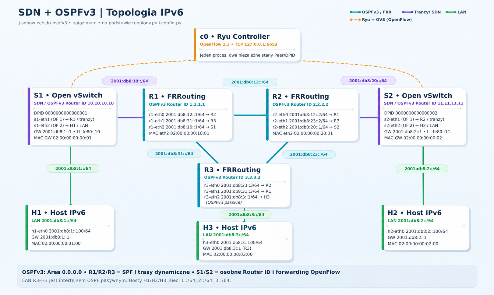

# sdn-ospfv3 — integracja SDN i OSPFv3

Autorska aplikacja **Ryu i OpenFlow 1.3** integrująca dwie sieci IPv6
zarządzane przez SDN z klasycznymi routerami FRRouting. **Jedna instancja
Ryu** prowadzi dwa niezależne sąsiedztwa OSPFv3: S1 z R1 i S2 z R2.
FRRouting działa wyłącznie w routerach R1, R2 i R3. To demonstrator dla
jednej ustalonej topologii, a nie uniwersalny router.

## Struktura

| Plik | Odpowiedzialność |
| --- | --- |
| `controller.py` | Mapa DPID → datapath/Peer, reguły OpenFlow, NDP i bramy IPv6 |
| `peer.py` | Stan jednego sąsiada OSPFv3, Hello/DBD/LSR/LSU/LSAck, timery |
| `packets.py` | Kodowanie, walidacja OSPFv3 i lokalne LSA przez Scapy |
| `config.py` | Dwa zestawy adresów, Router ID, portów i MAC indeksowane DPID |
| `topology.py` | Containernet: R1–R2–R3, S1/S2, H1/H2/H3 |
| `tests/` | Testy konfiguracji, ramek/LSA, stanów Peer i reguł OpenFlow |
| `run_ryu.py` | Launcher Ryu |
| `archive/legacy-integration/` | Archiwum dotychczasowych scenariuszy integracyjnych |

Więcej: [architektura](docs/ARCHITEKTURA.md).



## Stała topologia

| OVS (DPID) | Sąsiad FRR | Router ID OSPFv3 | LAN SDN / host | Tranzyt |
| --- | --- | --- | --- | --- |
| S1 (1) | R1 (`r1-eth2`) | `10.10.10.10` | `2001:db8:1::/64`, H1 `::100` | `2001:db8:10::/64` |
| S2 (2) | R2 (`r2-eth2`) | `11.11.11.11` | `2001:db8:2::/64`, H2 `::100` | `2001:db8:20::/64` |

Oba OVS mają port 1 do FRR i port 2 do hosta, ale własne MAC, link-local,
Interface ID i instancję `Peer`. R1–R2–R3 zachowują dotychczasowy trójkąt;
H3 jest podłączony bezpośrednio do R3 (`r3-eth2`) w `2001:db8:3::/64`.
R3 rozgłasza ten prefiks przez OSPFv3 z pasywnego interfejsu LAN.
W ten sposób każdy z trzech hostów H1/H2/H3 należy do sieci o tym samym
numerze `2001:db8:1/2/3::/64`, a R3 jest bramą odrębnego LAN.

## Uruchomienie na Ubuntu

Wymagane: Ubuntu z Pythonem 3, środowisko Ryu z Eventlet i Scapy,
Containernet, Docker, Open vSwitch (OpenFlow 1.3) oraz obraz
`frrouting/frr` z demonem `ospf6d`. Repozytorium nie zawiera instalatora
tych komponentów ani przypiętych wersji całego środowiska; domyślnie
`topology.py` pobiera `frrouting/frr:latest` (można ustawić `FRR_IMAGE`).

Terminal 1 (z katalogu repo, w sprawdzonym środowisku Ryu):

```bash
source ~/ryu-env/bin/activate
python3 run_ryu.py --ofp-tcp-listen-port 6653 controller.py
```

Terminal 2 (z katalogu repo):

```bash
sudo python3 topology.py
```

Nie uruchamiaj drugiej instancji Ryu ani Containernet. Poczekaj na
konwergencję OSPFv3. Wszystkie poniższe polecenia uruchom w interaktywnej
konsoli `containernet>` (prefiks `sh` wykonuje polecenie na hoście Ubuntu).

## Walidacja integracyjna — sześć osobnych testów

**TEST 1 — jeden kontroler i dwa DPID:**

```text
sh ovs-vsctl get-controller s1
sh ovs-vsctl get-controller s2
sh ovs-ofctl -O OpenFlow13 show s1
sh ovs-ofctl -O OpenFlow13 show s2
```

Obie listy kontrolerów powinny wskazywać `tcp:127.0.0.1:6653`, a odpowiedzi
OpenFlow dwa różne `dpid:0000000000000001` i `dpid:0000000000000002`.
W logu jednego Ryu powinny pojawić się instalacje reguł dla DPID 1 i 2.

**TEST 2 — dwa sąsiedztwa `Full`:**

```text
r1 vtysh -c 'show ipv6 ospf6 neighbor'
r2 vtysh -c 'show ipv6 ospf6 neighbor'
```

Na R1 sprawdź `10.10.10.10` oraz `Full`, na R2 `11.11.11.11` oraz `Full`.
Samo `two-way` lub `synchronized` w logu Ryu nie dowodzi `Full`.

**TEST 3 — LSDB, prefiksy i trasy OSPFv3:**

```text
r1 vtysh -c 'show ipv6 ospf6 database intra-prefix'
r2 vtysh -c 'show ipv6 ospf6 database intra-prefix'
r3 vtysh -c 'show ipv6 ospf6 database intra-prefix'
r1 vtysh -c 'show ipv6 route ospf6'
r2 vtysh -c 'show ipv6 route ospf6'
r3 vtysh -c 'show ipv6 route ospf6'
r2 ip -6 route show 2001:db8:1::/64
r1 ip -6 route show 2001:db8:2::/64
r2 ip -6 route show 2001:db8:3::/64
```

Zweryfikuj reklamy SDN `2001:db8:1::/64` (S1), `2001:db8:2::/64` (S2)
oraz klasyczny LAN `2001:db8:3::/64` (R3), a następnie trasy
wyuczone przez OSPFv3 na *zdalnych* routerach (nie tylko bezpośrednio
podłączone wpisy `connected`). Samo istnienie wpisów w LSDB nie dowodzi
zainstalowania tras.

**TEST 4 — dwukierunkowy forwarding IPv6:**

```text
h1 ping -6 -c 5 2001:db8:2::100
h2 ping -6 -c 5 2001:db8:1::100
h1 ping -6 -c 5 2001:db8:3::100
h3 ping -6 -c 5 2001:db8:1::100
h3 ping -6 -c 5 2001:db8:2::100
h2 ping -6 -c 5 2001:db8:3::100
h1 ip -6 neigh show dev h1-eth0
h2 ip -6 neigh show dev h2-eth0
```

**TEST 5 — reguły i liczniki OpenFlow:**

```text
sh ovs-ofctl -O OpenFlow13 dump-flows s1
sh ovs-ofctl -O OpenFlow13 dump-flows s2
h1 ping -6 -c 5 2001:db8:2::100
h2 ping -6 -c 5 2001:db8:1::100
sh ovs-ofctl -O OpenFlow13 dump-flows s1
sh ovs-ofctl -O OpenFlow13 dump-flows s2
```

Szukaj reguł `priority=100` z `dec_ttl`, przepisywaniem `eth_src`/`eth_dst`
i wyjściem na port 1 lub 2. Ich `n_packets` powinny wzrosnąć po pingach;
licznik samej reguły `priority=0` nie jest wystarczającym dowodem routingu.

**TEST 6 — niezależność przy utracie kontrolera przez S1:**

```text
r2 vtysh -c 'show ipv6 ospf6 neighbor'
sh ovs-vsctl set-controller s1 tcp:127.0.0.1:16653
sh sleep 50
r2 vtysh -c 'show ipv6 ospf6 neighbor'
sh ovs-vsctl set-controller s1 tcp:127.0.0.1:6653
sh ovs-ofctl -O OpenFlow13 show s1
r1 vtysh -c 'show ipv6 ospf6 neighbor'
r2 vtysh -c 'show ipv6 ospf6 neighbor'
h2 ping -6 -c 5 2001:db8:3::100
```

Zmiana portu na S1 jest celową, **tymczasową** awarią połączenia sterującego.
50 sekund przekracza OSPF Dead Interval (40 s); czas trwania sąsiedztwa
R2–S2 nie powinien się resetować.
Przywróć `6653` także wtedy, gdy test się nie powiedzie. Sąsiedztwo R2–S2
powinno pozostać `Full`, a R1–S1 odzyskać `Full` po ponownym połączeniu.

Powyższe komendy są **procedurą do wykonania**, a nie raportem z udanego
testu integracyjnego. Rzeczywisty stan i liczniki trzeba zebrać w środowisku
Containernet/FRRouting/Ryu. Historyczny scenariusz restartu kontrolera
pozostaje w [archiwum](archive/legacy-integration/TESTY.md).

## Testy bez Containernet

W środowisku z zainstalowanym Scapy (nie trzeba importować Ryu do testów):

```bash
python3 -m compileall -q controller.py peer.py packets.py config.py topology.py run_ryu.py tests
python3 -m unittest discover -s tests -v
```

Poprzedni skrypt integracyjny INT-01–INT-11 pozostaje w
[archiwum](archive/legacy-integration/README.md). Dotyczy starej topologii
z jednym OVS i nie zastępuje powyższych testów. Historyczne wyniki nie
potwierdzają działania wersji dwuswitchowej.

## Świadome ograniczenia

- Jeden sąsiad FRRouting **na każdy OVS** na łączu point-to-point, jeden
  obszar OSPFv3, stałe porty/MAC i obsługa roli DBD Master.
- Własne Hello, DBD, LSR, LSU, LSAck, lokalne Router/Link/Prefix-LSA
  i retransmisje; brak pełnego routera, dowolnej wielosąsiedzkiej LSDB i SPF.
- Każdy OVS ma dwie statyczne reguły routingu IPv6, tylko dla swojego
  z góry znanego hosta LAN. NDP obejmuje znane bramy i link-local tranzytu.
- Ryu **nie wykonuje SPF**: trasy w FRRouting wynikają z OSPFv3, a next-hop
  każdego OVS do jego FRR i lokalny host są skonfigurowane statycznie.
- Stan `Full`, trasy, działający forwarding i odzyskiwanie po utracie
  połączenia należy potwierdzić osobno zgodnie z testami 1–6.
